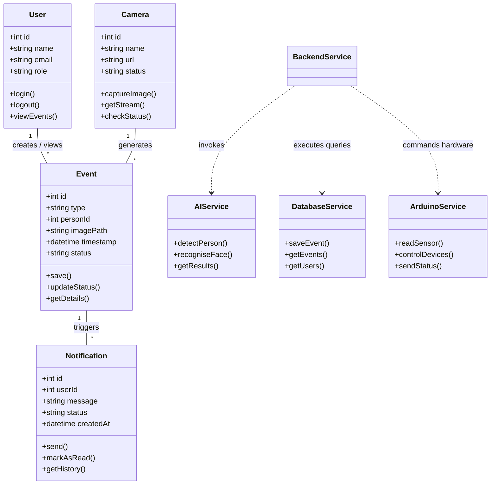

# Class System Diagram

---

## Class Definitions

* **User:** Represets system users (Admins, Operators) who manage configurations and receive alerts.
* **Event:** Represents a recorded security detection event (e.g., intruder detected, authorized user recognized).
* **Notification:** Handles outbound alert delivery logs to specific users.
* **Camera:** Encapsulates stream configurations, status monitoring, and image frame acquisition.
* **AIService:** Static/Utility service executing computer vision detection algorithms.
* **DatabaseService:** Abstracts database operations, queries, and ORM abstractions.
* **ArduinoService:** Serial interface client managing communication with edge hardware sensors and alarms.