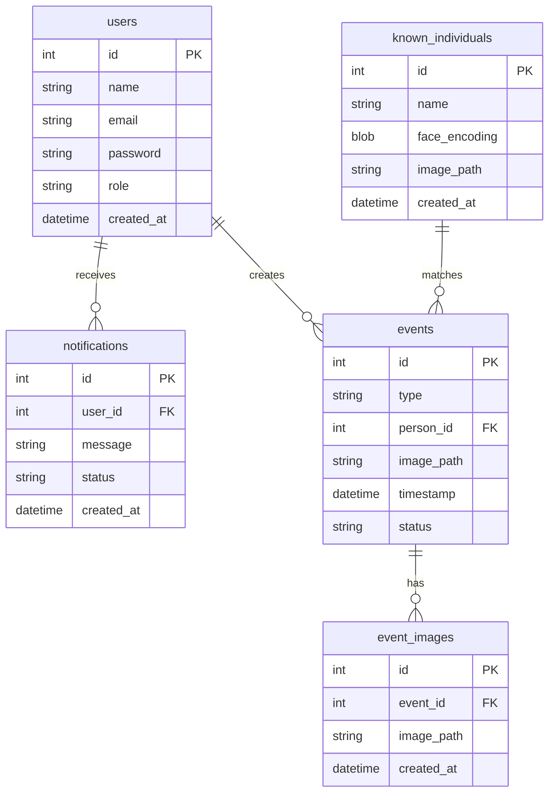

# Entity Relationship Diagram (ERD)

---

## Data Dictionary

### 1. `users` Table
* **id (INT, PK):** Unique identifier for users.
* **email (VARCHAR):** User login credential.
* **password (VARCHAR):** Bcrypt-hashed password.
* **role (VARCHAR):** Access control level (`admin`, `operator`).

### 2. `events` Table
* **id (INT, PK):** Unique security event ID.
* **type (VARCHAR):** Classification (`Motion`, `Person Detected`, `Unknown Face`, `Authorized Access`).
* **person_id (INT, FK):** References `known_individuals.id` if matched.
* **status (VARCHAR):** Resolution state (`Unreviewed`, `Acknowledged`, `Cleared`).

### 3. `known_individuals` Table
* **id (INT, PK):** Unique entity ID.
* **name (VARCHAR):** Full name of registered individual.
* **face_encoding (BLOB/TEXT):** Vector embedding generated by InsightFace.

### 4. `notifications` Table
* **id (INT, PK):** Notification record ID.
* **user_id (INT, FK):** Target user recipient.
* **status (VARCHAR):** Delivery state (`Sent`, `Delivered`, `Failed`).