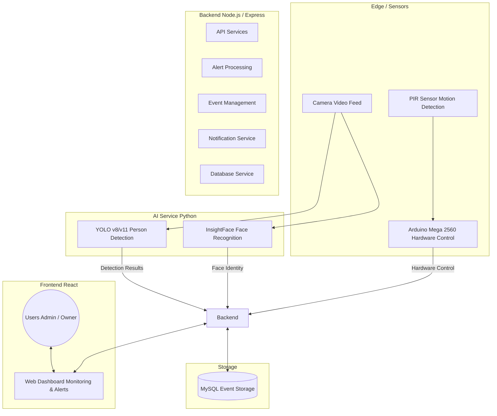

# System Architecture Diagram

## Architecture Overview

The **Smart AI CCTV Security System** uses a modular microservices-inspired architecture consisting of local execution components with optional cloud synchronization capabilities.

---

## Component Details

### 1. Edge & Hardware Layer
* **Camera:** Feeds continuous video streams to the AI Service for real-time frame processing.
* **PIR Sensor:** Provides passive infrared motion detection to trigger system waking states or alert escalation.
* **Arduino Mega 2560:** Manages low-level hardware integrations, including physical alarms, sirens, relays, and hardware state signals.

### 2. AI Processing Service (Python)
* **YOLO (You Only Look Once):** High-speed object detection model fine-tuned for real-time person detection.
* **InsightFace:** Deep learning facial recognition engine used to match detected faces against database-stored embeddings of known individuals.

### 3. Core Backend (Node.js / Express)
* **API Services:** Restful API endpoint handler for managing users, camera feeds, and configuration settings.
* **Alert & Event Processing:** Evaluates detection payloads against alert thresholds and triggers active workflows.
* **Notification Service:** Dispatches email, WebPush, and SMS alerts upon critical security events.
* **Database Service:** Manages persistent connections, transactional safety, and query executions to MySQL.

### 4. Storage & Frontend Layer
* **MySQL Database:** Stores structured logs, event metadata, face encodings, user profiles, and alert history.
* **React Web Dashboard:** Modern, responsive frontend application for live stream viewing, event history review, system monitoring, and administrative access control.

---

## Deployment Strategy
* **Primary Execution:** Local Edge Deployment (on-premise server / high-performance mini PC).
* **Optional Cloud Synchronization:** Encrypted event log backup, push notification relaying, and cloud media backup.