# Hardware and Software Budget & Procurement Guide

## Overview

This document outlines estimated hardware and software costs for assembling and deploying the **Smart AI-Powered CCTV Security System**. Software prices reflect the current development/demo setup and assume the listed open-source or community software is used under its applicable license terms.

All prices are quoted in Zambian Kwacha (ZMW / K).

---

## Estimated Hardware Costs

| No. | Hardware Component | Quantity | Average Cost (ZMW) | Total Cost (ZMW) |
| :-: | :--- | :-: | :-: | :-: |
| 1 | Arduino Mega 2560 | 1 | K950 | K950 |
| 2 | PIR Motion Sensor (HC-SR501) | 1 | K115 | K115 |
| 3 | Status LEDs | 2 | K15 | K30 |
| 4 | Passive Buzzer | 1 | K35 | K35 |
| 5 | Resistors for LEDs (220Ω) | 2 | K10 | K20 |
| 6 | Full-Size Solderless Breadboard | 1 | K75 | K75 |
| 7 | Jumper Wires (M-M / M-F / F-F) | 1 set | K55 | K55 |
| 8 | USB Type-A to Type-B Cable (Arduino) | 1 | K45 | K45 |
| 9 | USB Extension Cable | 1 | K75 | K75 |
| 10 | Workstation / Laptop (AI Processing & System Host) | 1 | K6,000 | K6,000 |
| **—** | **Hardware Subtotal** | **—** | **—** | **K7,400** |

## Estimated Software Costs

| No. | Software / Service | Purpose | Estimated Cost (ZMW) |
| :-: | :--- | :--- | :-: |
| 1 | Node.js, Express, React, and frontend build tools | Backend and dashboard runtime/build tools | K0 |
| 2 | Python, Flask, OpenCV, TensorFlow, and related packages | AI service and computer-vision runtime | K0 |
| 3 | MySQL Community Edition | Database | K0 |
| 4 | Arduino IDE | Microcontroller firmware development | K0 |
| 5 | Git | Source control | K0 |
| 6 | YOLO and InsightFace software/model assets | Object detection and face recognition | K0* |
| **—** | **Software Subtotal** | **Development/demo use; paid hosting and services excluded** | **K0** |

\* No purchase cost is budgeted for the current development/demo setup. Check the applicable licenses and model terms before commercial or production deployment; a commercial license or alternative model may incur additional costs. Paid cloud hosting, domain registration, and email/SMS delivery services are also not included.

---

## Cost Summary Breakdown

```mermaid
gantt
    title Hardware Budget Allocation
    dateFormat X
    axisFormat %s

    section Core Compute
    Laptop / Workstation (K6,000) : 0, 6000
    section Microcontroller
    Arduino Mega 2560 (K950) : 0, 950
    section Accessories & Sensors
    Sensors, Wiring & Peripherals (K450) : 0, 450
```

## Total Estimated System Budget

| Category | Estimated Cost (ZMW) |
| :--- | ---: |
| Hardware subtotal | K7,400 |
| Software subtotal | K0 |
| **Total estimated budget** | **K7,400** |

The hardware allocation is approximately 81.1% for the workstation, 12.8% for the microcontroller, and 6.1% for sensors and wiring. Software has no upfront license cost under the development/demo assumptions above.

---

## Component Specifications & Hardware Recommendations

### 1. Workstation / Laptop for AI Execution
* **Role:** Hosts the Python AI engine (YOLO & InsightFace), Node.js backend, and MySQL database.
* **Recommended Minimum Specs:** 
  * **CPU:** Intel Core i5 (8th Gen+) or AMD Ryzen 5
  * **RAM:** 8 GB DDR4 (16 GB recommended for multi-stream AI execution)
  * **Storage:** 256 GB SSD (for fast access to database frame logs)
  * **GPU (Optional):** NVIDIA GPU with CUDA support for accelerated frame detection rates.

### 2. Microcontroller & Sensor Integration
* **Arduino Mega 2560:** Selected over the Arduino Uno for higher available RAM, additional serial ports (UART), and expanded digital I/O pins for future sensor additions.
* **PIR Motion Sensor (HC-SR501):** Triggers initial wake commands or detection priority modes in the software pipeline when human movement is detected.
* **Passive Buzzer & LEDs:** Provide real-time local hardware feedback (e.g., Red LED for intrusion threat, Green LED for armed/standby state, Buzzer for audible alert).

---

## Additional Procurement & Setup Notes

1. **Power Supply:**
   * The Arduino Mega and sensors can be powered directly via the USB connection to the host laptop/PC during development and testing.
   * For production deployment, consider an external 9V 1A DC adapter for the Arduino to ensure stable relay operation.

2. **USB Extension Cabling:**
   * A USB extension cable allows extended placement of the camera or microcontroller unit away from the primary server host.

3. **Buffer & Contingency:**
   * It is recommended to keep a 5% to 10% contingency budget (approx. K350 - K700) for replacing small consumable items (resistors, damaged jumper wires, or breadboard damage).