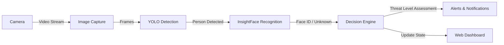

# System Design & Detailed Flow

## Detailed System Flow



---

## Main Modules Overview

### 1. Camera Module
Captures raw video frames from configured cameras (RTSP, Webcams, IP Cameras) and forwards stabilized frames for AI processing.

### 2. AI Module
* **YOLO Sub-module:** Performs high-speed frame analysis to detect human figures.
* **InsightFace Sub-module:** Extracts 512-d facial embeddings and compares them against stored feature vectors in MySQL to classify as `Known` or `Unknown`.

### 3. Backend Module
Handles core business logic, API endpoints, incoming events, user session validation, database connection pooling, and external trigger orchestrations.

### 4. Database Module
Manages structured data models for users, security events, known face embeddings, alert thresholds, and system execution logs.

### 5. Frontend Module
A single-page React application that displays real-time frame overlays, event feeds, alert toggles, and system logs.

### 6. Hardware Module
Manages microcontroller interfaces via serial protocols to trigger hardware relays, status LEDs, and audible alarm buzzers.

---

## Simplified Database Schema Overview

```
 +------------------+        +-------------------+
 |      USERS       |        +     EVENTS        |
 +------------------+        +-------------------+
 | id (PK)          |        | id (PK)           |
 | name             |        | type              |
 | email            |        | person_id (FK)    |
 | role             |        | image_path        |
 +------------------+        | timestamp         |
                             +-------------------+

 +------------------+        +-------------------+
 | KNOWN_INDIVIDUALS|        |   NOTIFICATIONS   |
 +------------------+        +-------------------+
 | id (PK)          |        | id (PK)           |
 | name             |        | user_id (FK)      |
 | face_encoding    |        | message           |
 +------------------+        | status            |
                             +-------------------+
```