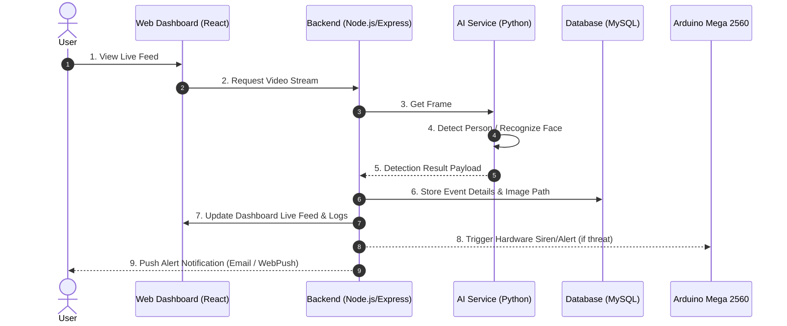

# System Sequence Diagram

The following sequence diagram outlines the operational workflow during a frame capture and threat analysis cycle.

---

## Execution Flow Steps
1. **User Request:** User accesses live stream via React frontend.
2. **Stream Initialization:** Express server coordinates stream processing pipeline.
3. **AI Evaluation:** Frame is passed to Python background service.
4. **Threat Detection:** YOLO checks for human presence; InsightFace performs face feature extraction.
5. **Payload Processing:** Results are structured into JSON payloads returned to backend.
6. **Data Persistence:** Detections exceeding threat thresholds are recorded to MySQL.
7. **UI Synchronization:** Socket/Polling service broadcasts event updates to dashboard.
8. **Hardware Trigger:** If intrusion is flagged, a serial command triggers Arduino hardware alarms.
9. **Dispatch Alert:** High-priority alerts are immediately delivered to admin devices.