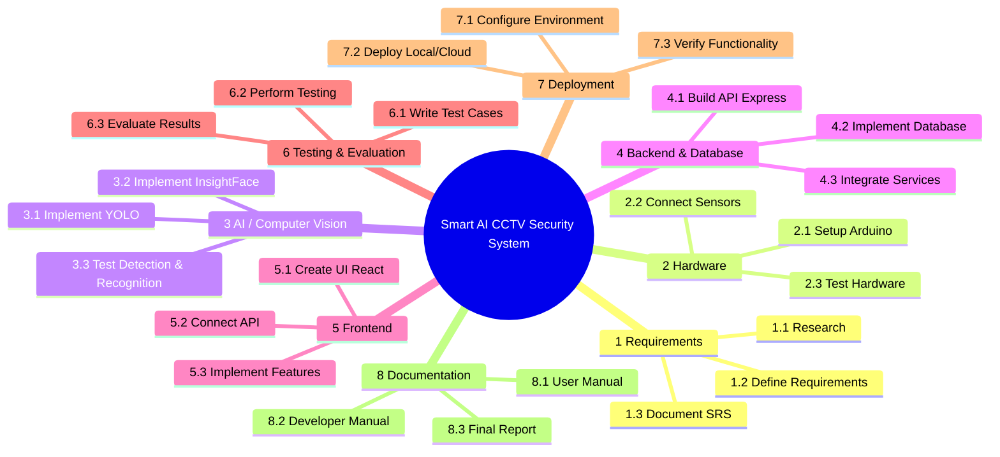

# Work Breakdown Structure (WBS)

---

## Task Breakdowns by Phase

### Phase 1: Requirements & Architecture
* Formalize functional/non-functional requirements.
* Design system diagrams and architecture blueprints.

### Phase 2: Hardware & Edge Setup
* Wire motion sensors and relays to Arduino Mega.
* Write microcontroller serial communication routines.

### Phase 3: AI Core Pipeline
* Integrate YOLO models for real-time target bounding.
* Build face identification pipeline with InsightFace embeddings.

### Phase 4: Full Stack Integration
* Construct Express API REST routes and socket notification bridges.
* Build modular React UI components for operational oversight.

### Phase 5: Verification & Deployment
* Execute performance tests under varied environmental conditions.
* Compile developer documentation and prepare release bundles.